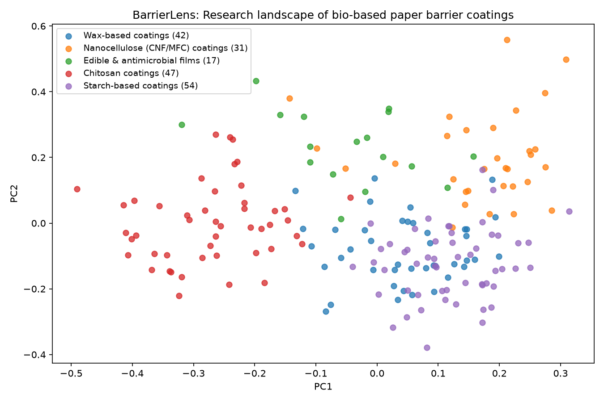

# BarrierLens

**A literature and data map of bio-based barrier coatings for paper packaging.**

Paper packaging still relies on polyethylene (PE) and PFAS coatings for water and grease resistance. BarrierLens maps the scientific literature on bio-based alternatives (chitosan, starch, alginate, proteins, nanocellulose, waxes, lignin/hemicellulose) and compiles published performance data, so that the most promising candidates for lab testing can be identified.

> **Goal:** not to declare "the best material", but to answer: *which material and method best meet a given set of requirements, and which 3–5 candidates are worth testing in the lab?*

---

## Pipeline

| Step | What | Output |
|---|---|---|
| 1. Collect | OpenAlex API, 7 material-specific queries, top 100 results each | 566 unique papers (`data/papers_raw.csv`) |
| 2. Screen | Title + abstract must mention *paper* + *coating* + a *barrier property*; relaxed rule for papers without abstract; 2 manual exclusions (documented in code) | 191 papers (`data/papers_screened.csv`) |
| 3. Map | Sentence embeddings (`all-MiniLM-L6-v2`), K-Means (k = 5), PCA for 2D view | 5 research clusters (`data/papers_clustered.csv`) |
| 4. Extract | Performance values from full-text, open-access papers, each linked to its table/figure | 43 samples from 6 papers (`data/performance_data.csv`) |

## Research landscape



| Cluster | Papers |
|---|---|
| Starch-based coatings | 54 |
| Chitosan coatings | 47 |
| Wax-based coatings | 42 |
| Nanocellulose (CNF/MFC) coatings | 31 |
| Edible & antimicrobial films | 17 |

**Observations**
- Chitosan and nanocellulose research form clearly separated clusters.
- Starch and wax research overlap strongly: a hydrophilic biopolymer is often combined with a hydrophobic component.
- Lignin/hemicellulose did not form its own cluster, which suggests fewer studies on these materials as paper coatings.

## Performance data (v1)

`data/performance_data.csv` contains **43 samples** (including uncoated controls) from 6 papers, with coating weight, KIT rating (grease), Cobb value (water absorption), WVTR (water vapour transmission), water contact angle, heat-sealability and repulpability where reported. Every value has a `source_location` (table/figure and page) for verification.

**First findings**
- **Chitosan** is a strong grease and water-vapour barrier: two layers (6 g/m²) reached KIT 12 [Kopacic 2018]; a ~5 g/m² chitosan coating reduced WVTR from 320 to 20 g/m²·day [Roman 2023].
- **But chitosan is weak against liquid water:** it made the paper surface more hydrophilic (higher Cobb, lower contact angle) [Kopacic 2018].
- **Waxes** give excellent water resistance: a degradable polymeric wax on a starch precoat lowered Cobb₁₈₀₀ from 164 to 4.1 g/m² and WVTR by ~95%, and was heat-sealable [Yadav 2024].
- **Starch + 7 wt% bentonite** reached KIT 12 on flat paper, but KIT 0 on a fold, so the crease is the weak point [Santos 2023].
- **MFC** allowed a barrier coating at 2.5 g/m² with the same KIT as a commercial latex at 8–10 g/m² [Kumar 2020].

**Working hypothesis:** a chitosan base layer (grease + vapour barrier) combined with a thin bio-wax top layer (water resistance), to be tested in the lab.

## Limitations

- **Test conditions differ between papers.** WVTR was measured at 23 °C / 50% RH or 38 °C / 90% RH; Cobb at 60, 120 or 1800 s. Values should only be compared under the same conditions (see `wvtr_conditions`, `cobb_conditions`).
- **Some values were read from figures** and are approximate (marked in `notes`).
- **OpenAlex open-access flags were not always accurate;** several selected papers were paywalled and were replaced.
- **Cluster labels are approximate:** clusters group papers by topic similarity, not strictly by material. The 2D map explains only ~15% of the variance; low silhouette scores (~0.05) show that clusters overlap.
- **Data extraction was AI-assisted** and manually spot-checked against the source PDFs.
- Only published data is included.

## Roadmap

- [ ] **v1.1** – Candidate selection script: define requirements (e.g. KIT ≥ 8, low Cobb, coat weight ≤ 10 g/m²) → filter → rank
- [ ] **v1.2** – Interactive Streamlit dashboard
- [ ] **v2** – More papers per cluster (nanocellulose + chitosan, starch-alginate, lignin)
- [ ] Lab validation of the top candidates

## Repository structure

```
data/
  papers_raw.csv          566 collected papers
  papers_screened.csv     191 papers after screening
  papers_clustered.csv    papers with cluster labels and 2D coordinates
  landscape_map.png       research landscape figure
  shortlist.csv           candidate papers for data extraction
  selected_papers.csv     papers selected for extraction
  performance_data.csv    extracted performance data
notebooks/
  01_openalex_test.ipynb
  02_collect_papers.ipynb
  03_landscape_map.ipynb
  04_performance_table.ipynb
```

## Sources (performance data)

- Kopacic, S. et al. (2018). *Polymers*, 10, 1232. https://doi.org/10.3390/polym10111232
- Kumar, V. et al. (2020). *Coatings*, 10, 1108. https://doi.org/10.3390/coatings10111108
- Roman, M. et al. (2023). *Coatings*, 13, 1761. https://doi.org/10.3390/coatings13101761
- Santos, A. D. A. D. et al. (2023). *Nordic Pulp & Paper Research Journal*, 38(2). https://doi.org/10.1515/npprj-2022-0104
- Yadav, S. et al. (2024). *ACS Applied Polymer Materials*, 6, 3263. https://doi.org/10.1021/acsapm.3c03072
- Jahangiri, F. et al. (2025). *ACS Environmental Au*, 5, 165. https://doi.org/10.1021/acsenvironau.4c00055

Literature metadata: [OpenAlex](https://openalex.org).

## Author

**Nazrin Shahpalangova** – MSc Biological Resources, Hochschule Rhein-Waal
[LinkedIn](https://www.linkedin.com/in/nazrin-shahpalangova-72834a396)
